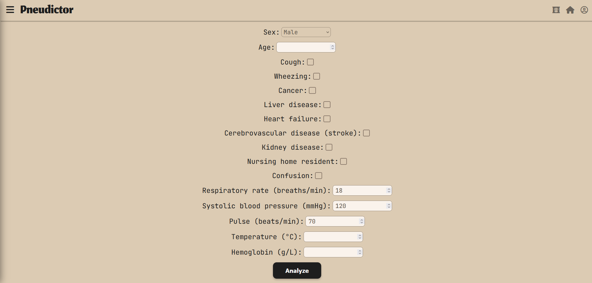
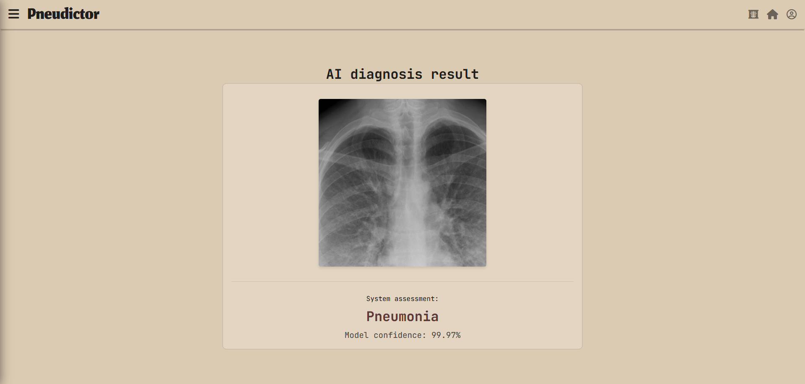
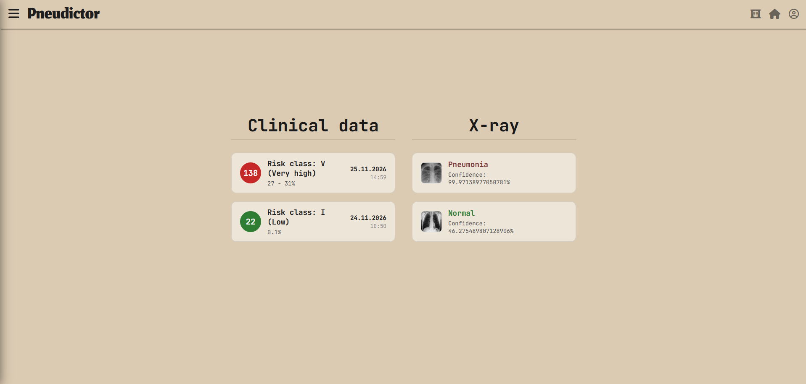

# Pneudictor


**Pneudictor** is a Django web application that combines deep learning–based chest X-ray classification with clinical **Pneumonia Severity Index (PSI)** risk scoring to assist in pneumonia screening and severity estimation.

> **Medical Disclaimer:** Pneudictor is built strictly for educational and portfolio purposes. It is **not** a certified medical device and must not be used for clinical decision-making or as a substitute for professional medical advice, diagnosis, or treatment.

---

## Features

- **Chest X-Ray Analysis (Deep Learning):** Classifies uploaded chest X-ray images as `normal` or `pneumonia` with a confidence percentage using a trained **MobileNetV2** (TensorFlow/Keras) model.
- **Lazy-Loaded ML Pipeline:** The `.h5` model is isolated in `diagnosis/ml.py` and loaded lazily on first inference, keeping server startup and unit test execution fast while caching the model in memory for subsequent requests.
- **Clinical PSI Risk Calculator:** Evaluates patient demographics, comorbidities, vital signs, and hemoglobin levels to compute the Pneumonia Severity Index score, Risk Class (**I–V**), and estimated mortality range.
- **User Accounts & Private History:** Custom user authentication (sign up, login, profile updates, password change) with a personal history dashboard displaying recent clinical and X-ray analyses. Strict per-user access control prevents users from viewing other patients' records.
- **Stripe Checkout Integration:** Supports upgrading to Pneudictor Premium via Stripe Checkout sessions with error handling.
- **Automated Testing & Cross-Platform CI:** 44 unit and integration tests executed via GitHub Actions on Ubuntu, macOS, and Windows with an enforced **80%+ test coverage** gate.

---

## Tech Stack

- **Backend:** Python 3.13, Django 6.0
- **Machine Learning:** TensorFlow / Keras (MobileNetV2, Adam optimizer), NumPy
- **Payments:** Stripe Checkout API
- **Database:** SQLite (default for local development & testing)
- **Testing & CI:** `pytest`, `pytest-django`, `pytest-mock`, `pytest-cov`, GitHub Actions

---

## Project Structure

```text
Pneudictor/
├── .github/workflows/
│   └── ci.yml                  # Cross-platform CI pipeline (Ubuntu, macOS, Windows)
├── accounts/                   # Custom user auth, profiles, and Stripe checkout
│   ├── tests/
│   │   └── test_views.py       # Mocked Stripe checkout unit & regression tests
│   ├── models.py
│   ├── urls.py
│   └── views.py
├── config/                     # Django project settings and root URLs
├── diagnosis/                  # Core clinical PSI & X-ray analysis app
│   ├── models/                 # Trained MobileNetV2 .h5 model
│   ├── tests/
│   │   ├── test_ml.py          # ML inference, lazy-loading & error handling tests
│   │   ├── test_utils.py       # Parametrized PSI scoring & risk class boundary tests
│   │   └── test_views.py       # Auth & data-isolation integration tests
│   ├── ml.py                   # TensorFlow preprocessing & cached model inference
│   ├── models.py               # ClinicalData & XRayData models
│   ├── utils.py                # Pure clinical PSI score & risk class calculations
│   └── views.py
├── notebooks/                  # Model training & evaluation Jupyter notebook
├── conftest.py                 # Shared pytest fixtures (user factory)
├── pytest.ini                  # Pytest configuration and custom markers
├── requirements.txt
└── manage.py
```

---

## Getting Started

### 1. Clone the Repository

```bash
git clone https://github.com/and1maestro/Pneudictor.git
cd Pneudictor
```

### 2. Create and Activate a Virtual Environment

```bash
python -m venv .venv
```

- **Windows (PowerShell):**
  ```powershell
  .venv\Scripts\Activate.ps1
  ```
- **macOS / Linux:**
  ```bash
  source .venv/bin/activate
  ```

### 3. Install Dependencies

```bash
python -m pip install --upgrade pip
pip install -r requirements.txt
```

### 4. Configure Environment Variables

Create a `.env` file in the project root (next to `manage.py`):

```env
SECRET_KEY=your-django-secret-key
STRIPE_SECRET_KEY=sk_test_your_stripe_secret_key
```

*(Add any other environment variables required by your local `config/settings.py`, such as `DEBUG=True` or `STRIPE_PUBLIC_KEY`.)*

### 5. Run Migrations and Start the Server

```bash
python manage.py migrate
python manage.py runserver
```

Visit `http://127.0.0.1:8000/` in your browser.

---

## Running Tests

Install the testing dependencies if they are not already installed:

```bash
pip install pytest pytest-django pytest-mock pytest-cov
```

Run the full test suite with coverage:

```bash
pytest --cov=diagnosis --cov=accounts --cov-report=term-missing
```

Run specific layers using custom pytest markers:

```bash
# Fast, isolated unit tests (PSI logic, mocked ML pipeline, mocked Stripe views)
pytest -m unit -v

# Database-backed integration tests (authentication & per-user access control)
pytest -m integration -v
```

---

## Screenshots

- *Home / Clinical PSI Assessment Form*


- *Chest X-Ray Upload & Prediction Result*


- *User Diagnosis History Dashboard*


---

## License

This project is open source and available under the [MIT License](LICENSE).